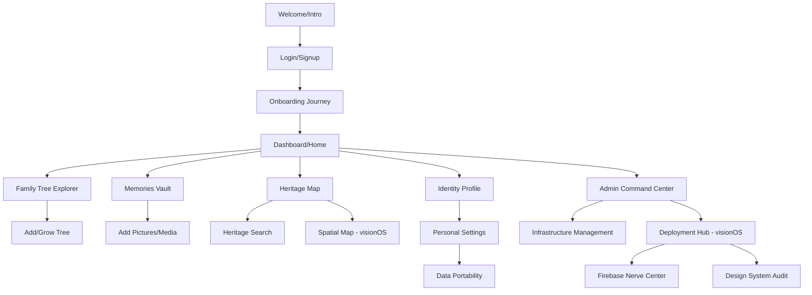
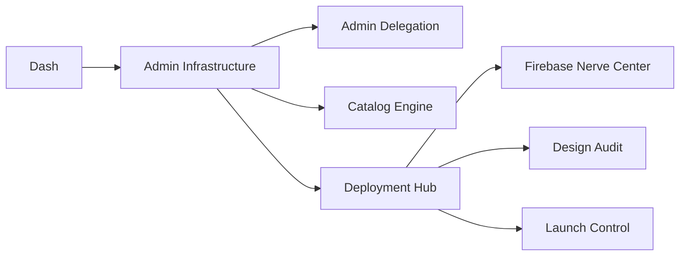

# Aevum - User Flow Architecture

This document visualizes the connectivity between all **57 Stitch Designs**, ensuring a seamless journey from onboarding to advanced admin management.

## 🗺️ High-Level Application Flow

## 🔄 Module Connectivity Details

### 1. The Entry Loop (Onboarding)

- **Welcome (4 variants)**: Introduction screens guiding users to start.
- **Auth (1 screen)**: Secure login.
- **Journey (6 variants)**: Sequential onboarding steps ("Start Your Journey").
- **Privacy (1 screen)**: Final rules and consent.

### 2. The Admin Command Center

- **VisionOS Compatibility**: Managed via the **Deployment Hub (Spatial Milestone)**, linking code builds to RealityKit/visionOS outputs.

### 3. Family Heritage & AI

- **Tree Growth**: Mapping `identify_&_grow_tree` as the action point for adding new people.
- **Memories**: `member_memories` (4 variants) handle the media gallery and upload flow.
- **AI Suite**: `ai_identity_matcher` and `ai_family_chronicles` are accessible from the Dashboard for deep lineage analysis.

## 🏁 Flow Termination & Tie-Backs

Every sub-module (Identity, Map, Memories, Admin) features a **Global Navigation Bar** (documented in `WelcomeScreen.jsx`) or a **Back/Home Button** that returns the user to the central Dashboard.
